# LAPORAN PRAKTIKUM 8: PHP dan MySQL (CRUD Data Barang)

| | |
| --- | --- |
| **Nama** | Khairi Ramadhan Yudhatama (312510099) |
| **Kelas** | Pemrograman Web (I251A) |
| **Dosen** | Agung Nugroho, S.Kom., M.Kom. |

---

## Ringkasan

Praktikum ini membangun aplikasi CRUD (Create, Read, Update, Delete) sederhana untuk data barang memakai PHP dan MySQL di lingkungan XAMPP. Alurnya: menyiapkan server, membuat database dan tabel, menghubungkan PHP ke MySQL, lalu membuat empat halaman yang menangani tampil data, tambah data, ubah data, dan hapus data.

Isi repository:

| File / Folder | Keterangan |
| --- | --- |
| `koneksi.php` | Membuka koneksi PHP ke database MySQL |
| `index.php` | Halaman utama, menampilkan tabel data barang (Read) |
| `tambah.php` | Form dan proses tambah data (Create) |
| `ubah.php` | Form dan proses ubah data (Update) |
| `hapus.php` | Proses hapus data (Delete) |
| `style.css` | Aturan tampilan untuk seluruh halaman |
| `screenshot/` | Screenshot setiap langkah praktikum |

---

## 1. Persiapan: Mengaktifkan Apache dan MySQL

Langkah pertama adalah menyalakan dua service di XAMPP Control Panel, yaitu **Apache** sebagai web server dan **MySQL** sebagai database server. Keduanya harus berstatus running sebelum halaman PHP bisa diakses.

Klik tombol **Start** pada baris Apache dan MySQL. Setelah service berjalan, Apache memakai port 80 dan 443, sedangkan MySQL memakai port 3306.

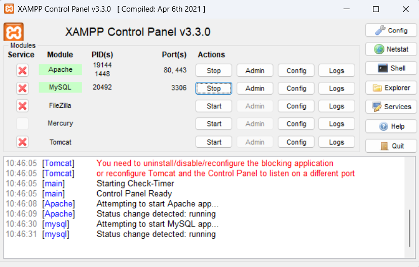

---

## 2. Membuat Database dan Tabel

Database dibuat melalui menu SQL di phpMyAdmin. Database diberi nama `latihan1`, kemudian dibuat tabel `data_barang` dengan tujuh kolom.

```sql
CREATE DATABASE latihan1;

USE latihan1;

CREATE TABLE data_barang (
    id_barang int(10) auto_increment Primary Key,
    kategori varchar(30),
    nama varchar(30),
    gambar varchar(100),
    harga_beli decimal(10,0),
    harga_jual decimal(10,0),
    stok int(4)
);
```

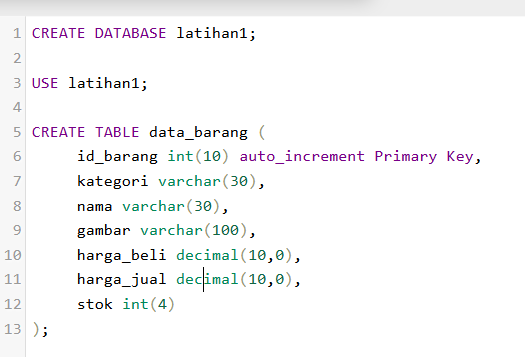

Hasil eksekusi di phpMyAdmin:

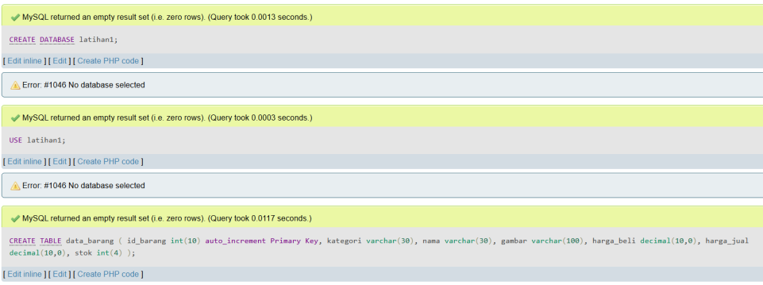

Pada screenshot hasil di atas, tiap query tetap menghasilkan baris hijau **"MySQL returned an empty result set"**, tetapi di bawahnya muncul peringatan **"Error #1046 No database selected"**. Peringatan itu berasal dari phpMyAdmin yang belum memilih database aktif di panel kiri, bukan dari query-nya. Buktinya, tabel `data_barang` tetap terbentuk dan bisa diisi data seperti terlihat pada langkah berikutnya.

---

## 3. Menambahkan Data ke Tabel

Tiga baris data contoh dimasukkan langsung lewat query `INSERT` untuk mengisi tabel sebelum halaman web dibuat.

```sql
INSERT INTO data_barang (kategori, nama, gambar, harga_beli, harga_jual, stok)
VALUES ('Elektronik', 'HP Samsung Android', 'hp_samsung.jpg', 2000000, 2400000, 5),
       ('Elektronik', 'HP Xiaomi Android', 'hp_xiaomi.jpg', 1000000, 1400000, 5),
       ('Elektronik', 'HP OPPO Android', 'hp_oppo.jpg', 1800000, 2300000, 5);
```

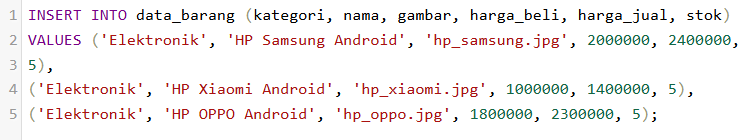

Setelah query dijalankan, tabel `data_barang` berisi tiga baris dengan `id_barang` 1 sampai 3:

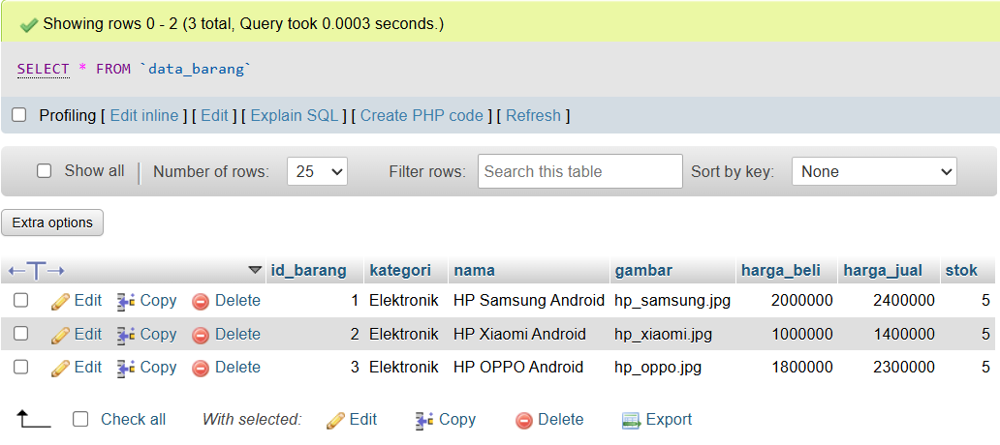

---

## 4. Membuat Program CRUD

Folder kerja `lab8_php_database` dibuat di dalam `htdocs` XAMPP. Folder ini menjadi root aplikasi yang diakses lewat browser.

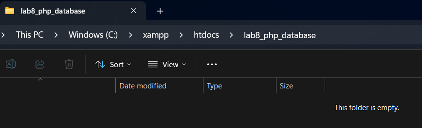

Folder kosong tersebut diakses melalui `http://localhost/lab8_php_database/`. Karena belum ada `index.php`, Apache menampilkan daftar isi direktori.

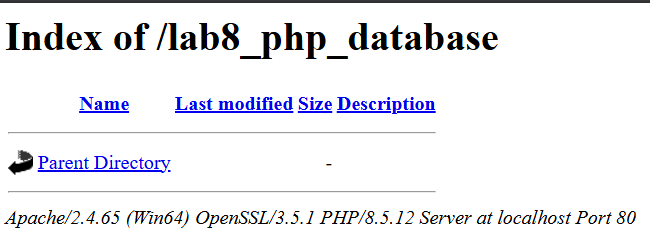

---

## 5. Membuat Koneksi Database (`koneksi.php`)

File `koneksi.php` menyimpan konfigurasi koneksi dan dipanggil oleh semua halaman lain memakai `include_once`. Fungsi `mysqli_connect()` menerima host, user, password, dan nama database.

```php
<?php
$host = "localhost";
$user = "root";
$pass = "";
$db = "latihan1";
$conn = mysqli_connect($host, $user, $pass, $db);
if ($conn == false)
{
    echo "Koneksi ke server gagal.";
    die();
}else echo "Koneksi berhasil";
?>
```

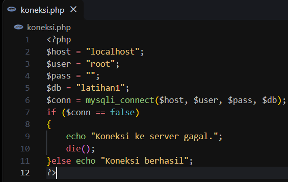

Halaman diuji dengan membuka `http://localhost/lab8_php_database/koneksi.php`. Teks **"Koneksi berhasil"** muncul, artinya PHP sudah tersambung ke database `latihan1`.

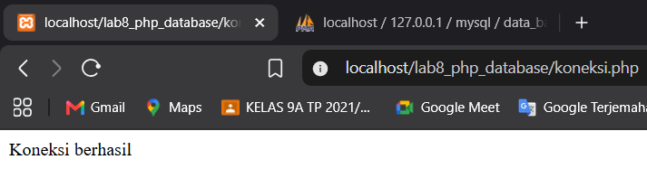

---

## 6. Menampilkan Data / Read (`index.php`)

`index.php` mengambil seluruh isi tabel dengan `SELECT * FROM data_barang`, lalu menampilkannya dalam tabel HTML. Perulangan `while` membaca setiap baris hasil query, dan blok `else` menangani kondisi saat tabel masih kosong.

```php
<?php
include("koneksi.php");
// query untuk menampilkan data
$sql = 'SELECT * FROM data_barang';
$result = mysqli_query($conn, $sql);
?>
```

Bagian yang mencetak isi tabel:

```php
<?php if($result): ?>
<?php while($row = mysqli_fetch_array($result)): ?>
<tr>
<td>" alt="<?= $row['nama'];?>"></td>
<td><?= $row['nama'];?></td>
<td><?= $row['kategori'];?></td>
<td><?= $row['harga_beli'];?></td>
<td><?= $row['harga_jual'];?></td>
<td><?= $row['stok'];?></td>
<td><a href="ubah.php?id=<?= $row['id_barang'];?>">Ubah</a> |
    <a href="hapus.php?id=<?= $row['id_barang'];?>">Hapus</a></td>
</tr>
<?php endwhile; else: ?>
<tr><td colspan="7">Belum ada data</td></tr>
<?php endif; ?>
```

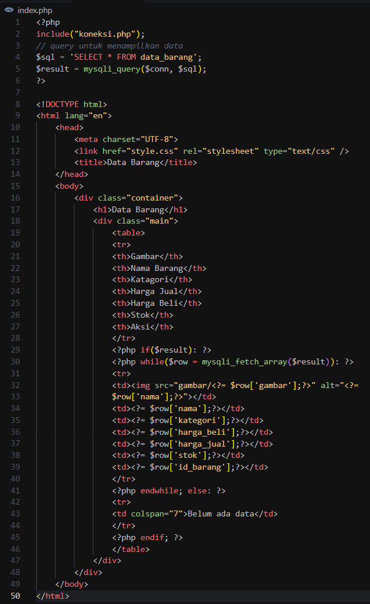

Hasil di browser: tiga baris data tampil lengkap dengan kolom Gambar, Nama Barang, Katagori, Harga Jual, Harga Beli, Stok, dan Aksi.

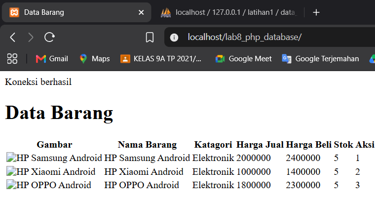

Pada kolom Gambar masih muncul ikon gambar rusak. Penyebabnya, file gambar (`hp_samsung.jpg` dan lainnya) belum ada di dalam folder `gambar/`, sedangkan nama filenya sudah tercatat di database.

---

## 7. Menambah Data / Create (`tambah.php`)

`tambah.php` menangani dua hal sekaligus: memproses kiriman form dan menampilkan form input.

Proses simpan berjalan ketika tombol submit ditekan. Data teks diambil dari `$_POST`, file gambar diambil dari `$_FILES`, lalu file dipindahkan ke folder `gambar/` dengan `move_uploaded_file()` sebelum query `INSERT` dijalankan.

```php
if (isset($_POST['submit']))
{
    $nama = $_POST['nama'];
    $kategori = $_POST['kategori'];
    $harga_jual = $_POST['harga_jual'];
    $harga_beli = $_POST['harga_beli'];
    $stok = $_POST['stok'];
    $file_gambar = $_FILES['file_gambar'];
    $gambar = null;

    if ($file_gambar['error'] == 0)
    {
        $filename = str_replace(' ', '_', $file_gambar['name']);
        $destination = dirname(__FILE__) . '/gambar/' . $filename;
        if (move_uploaded_file($file_gambar['tmp_name'], $destination))
        {
            $gambar = 'gambar/' . $filename;
        }
    }

    $sql = 'INSERT INTO data_barang (nama, kategori, harga_jual, harga_beli, stok, gambar) ';
    $sql .= "VALUE ('{$nama}', '{$kategori}', '{$harga_jual}', '{$harga_beli}', '{$stok}', '{$gambar}')";
    $result = mysqli_query($conn, $sql);
    header('location: index.php');
}
```

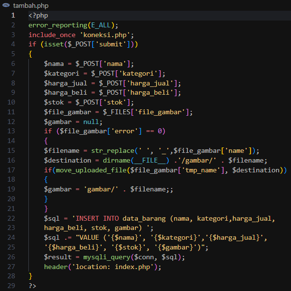

Form input memakai `method="post"` dan `enctype="multipart/form-data"` agar file gambar bisa ikut terkirim. Kategori disediakan sebagai dropdown dengan tiga pilihan: Komputer, Elektronik, dan Hand Phone.

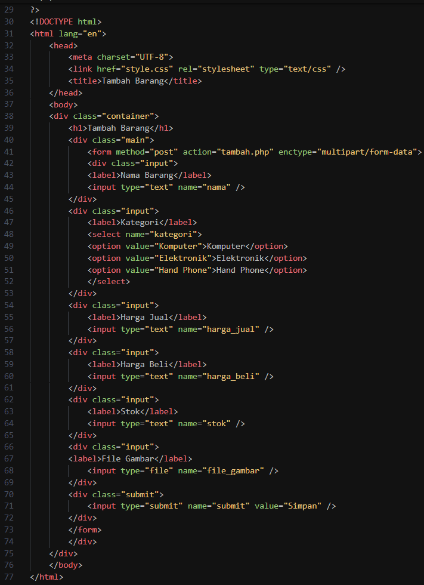

Tampilan form di browser:

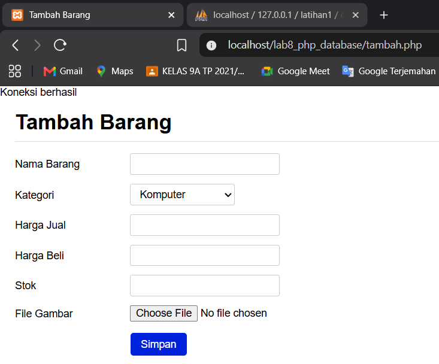

---

## 8. Mengubah Data / Update (`ubah.php`)

`ubah.php` menampilkan data lama ke dalam form, lalu menyimpan perubahannya. Alurnya: ambil `id` dari URL, baca baris yang sesuai, isi nilai ke setiap input, dan jalankan `UPDATE` saat form dikirim.

```php
$id = $_GET['id'];
$sql = "SELECT * FROM data_barang WHERE id_barang = '{$id}'";
$result = mysqli_query($conn, $sql);
if (!$result) die('Error: Data tidak tersedia');
$data = mysqli_fetch_array($result);

function is_select($var, $val) {
    if ($var == $val) return 'selected="selected"';
    return false;
}
```

Proses simpan perubahannya:

```php
$sql = 'UPDATE data_barang SET ';
$sql .= "nama = '{$nama}', kategori = '{$kategori}', ";
$sql .= "harga_jual = '{$harga_jual}', harga_beli = '{$harga_beli}', stok = '{$stok}' ";
if (!empty($gambar))
    $sql .= ", gambar = '{$gambar}' ";
$sql .= "WHERE id_barang = '{$id}'";
$result = mysqli_query($conn, $sql);
header('location: index.php');
```

Perhatikan `if (!empty($gambar))`: kolom gambar hanya ikut diperbarui kalau user benar-benar mengunggah file baru. Kalau tidak, gambar lama tetap dipakai.

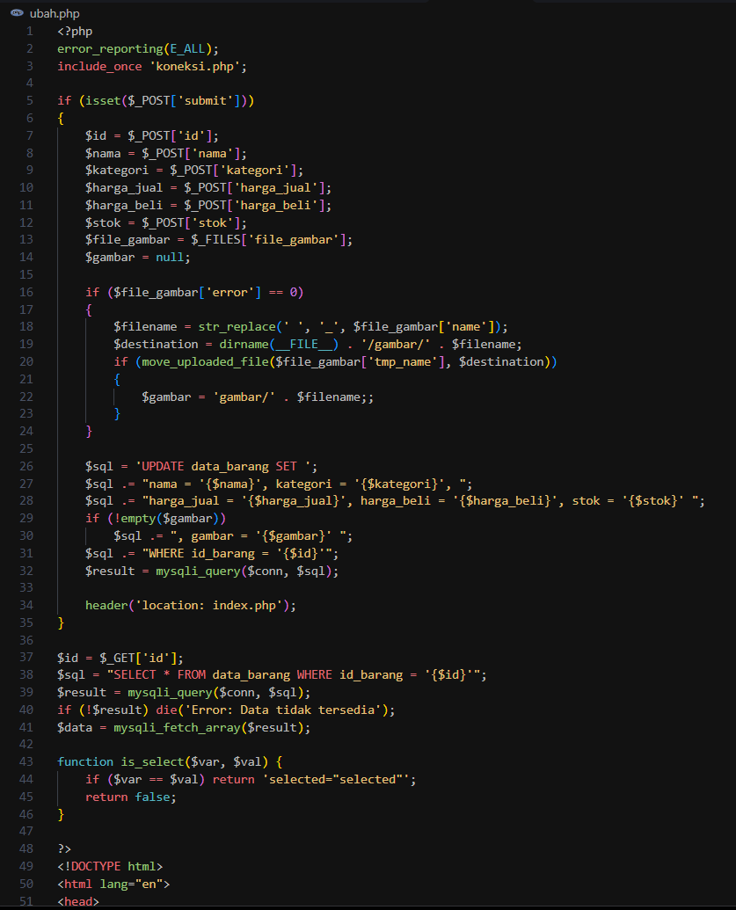

Bagian form diisi nilai awal dari variabel `$data`, dan `id_barang` dikirim lewat input hidden supaya query `UPDATE` tahu baris mana yang diubah.

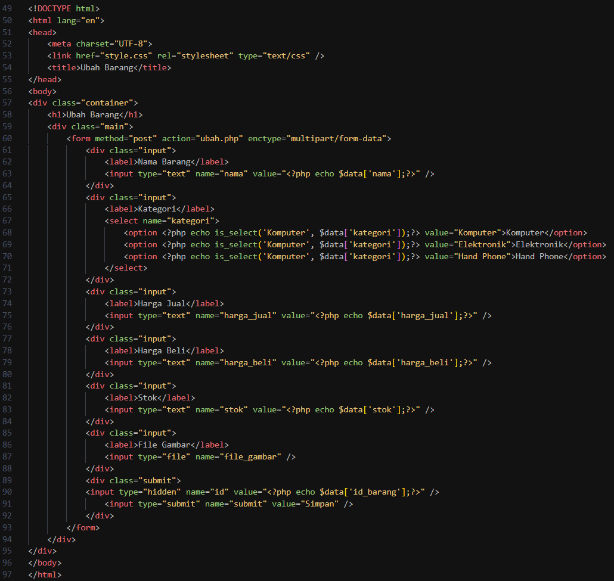

Tampilan form ubah untuk data dengan `id=1`. Semua kolom sudah terisi nilai sebelumnya:

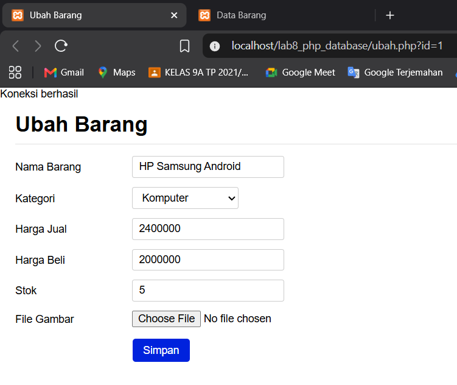

---

## 9. Menghapus Data / Delete (`hapus.php`)

`hapus.php` adalah file proses paling singkat. `id` diambil dari URL, query `DELETE` dijalankan, lalu user diarahkan kembali ke halaman utama.

```php
<?php
include_once 'koneksi.php';
$id = $_GET['id'];
$sql = "DELETE FROM data_barang WHERE id_barang = '{$id}'";
$result = mysqli_query($conn, $sql);
header('location: index.php');
?>
```

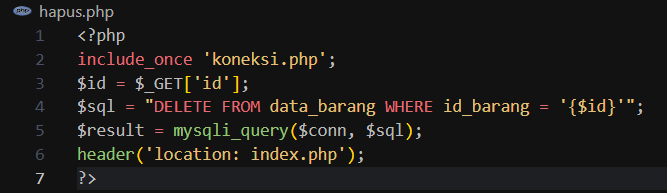

Data sebelum penghapusan, masih tiga baris:

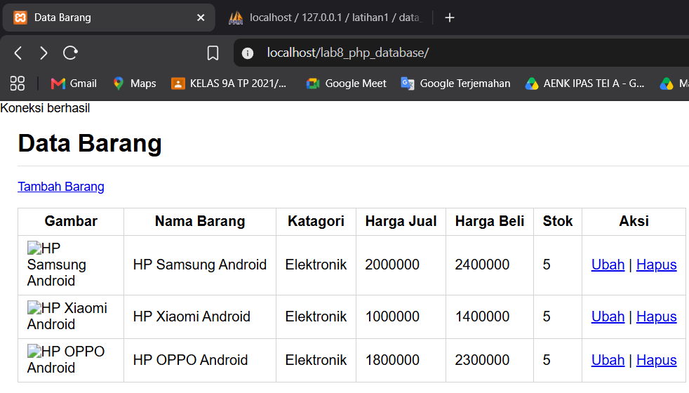

Data setelah baris **HP OPPO Android** dihapus lewat tautan Hapus pada baris tersebut, tersisa dua baris:

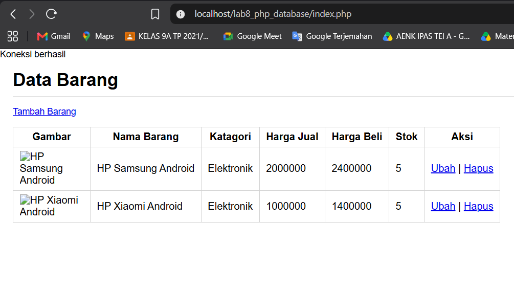

---

## Struktur Proyek

Folder proyek ini diletakkan di `htdocs/lab8_php_database/` agar bisa diakses lewat browser.

```
lab8_php_database/
├── index.php
├── koneksi.php
├── tambah.php
├── ubah.php
├── hapus.php
├── style.css
├── README.md
└── screenshot/
```

## Alur CRUD

| Aksi | File | Query | Pemicu |
| --- | --- | --- | --- |
| Create | `tambah.php` | `INSERT INTO data_barang` | Submit form tambah |
| Read | `index.php` | `SELECT * FROM data_barang` | Buka halaman utama |
| Update | `ubah.php` | `UPDATE data_barang SET ... WHERE id_barang` | Submit form ubah |
| Delete | `hapus.php` | `DELETE FROM data_barang WHERE id_barang` | Klik tautan Hapus |

## Cara Menjalankan

1. Salin folder proyek ke `C:\xampp\htdocs\`.
2. Jalankan Apache dan MySQL dari XAMPP Control Panel.
3. Buat database `latihan1` dan tabel `data_barang` memakai query pada langkah 2.
4. Buat folder `gambar/` di dalam folder proyek agar upload file berjalan.
5. Buka `http://localhost/lab8_php_database/` di browser.

## Kesimpulan

Praktikum ini menghasilkan aplikasi CRUD data barang yang berjalan di atas PHP dan MySQL. Empat operasi dasar sudah berfungsi: menampilkan data dari tabel, menambah data baru lewat form, mengubah data yang sudah ada, dan menghapus data berdasarkan `id_barang`. Koneksi database dipisahkan ke dalam satu file agar tidak ditulis berulang di setiap halaman.

Dari sisi tampilan, aplikasi masih memakai form dan tabel HTML dasar dengan sedikit bantuan CSS, sehingga pengembangan berikutnya bisa diarahkan ke validasi input, pengamanan query, serta penanganan file gambar yang lebih lengkap.
